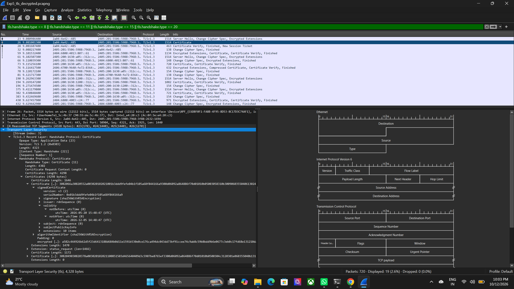
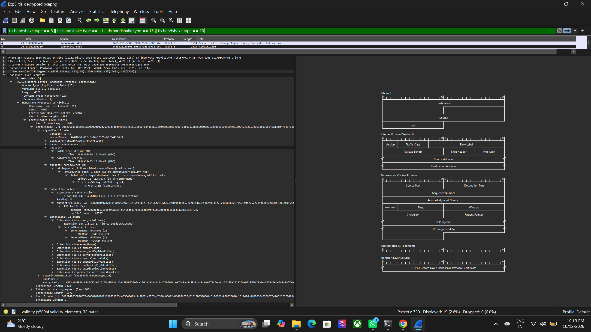

# Experiment 5: Capture and Analyze TLS Handshake using Wireshark

## 1. Objective

To use Wireshark to observe and dissect the TLS handshake process during HTTPS communication.

## 2. Brief Theory

**TLS (Transport Layer Security):** A cryptographic protocol that provides confidentiality, integrity, and authentication for network communication.

**HTTPS:** Uses TLS to protect communication between a web browser and a web server.

**TLS Handshake:** The process through which a client and server negotiate security parameters, establish shared cryptographic keys, and authenticate the server.

**ClientHello:** The initial handshake message containing supported TLS versions, cipher suites, and key-share information.

**ServerHello:** The server's response selecting the TLS version, cipher suite, and key-share parameters.

**Digital Certificate:** An electronic document that associates a server's identity with its public key.

**TLS Key Logging:** A mechanism for saving session secrets so Wireshark can decrypt captured TLS traffic for analysis.

## 3. Procedure

### Step 1: Capture HTTPS Traffic

Wireshark was opened, and the active network interface was selected. HTTPS traffic was captured using the display filter `tcp port 443` while accessing `https://www.wireshark.org/`. The capture was saved in `.pcapng` format.

Capture files: [Original TLS Capture](Outputs/Exp5_tls_handshake.pcapng) | [Decrypted TLS Capture](Outputs/Exp5_tls_decrypted.pcapng)

### Step 2: Analyze the ClientHello Message

The display filter `tls.handshake.type == 1` was applied to locate ClientHello packets. The supported TLS versions, offered cipher suites, server name, and key-share information were examined.

### Step 3: Analyze the ServerHello Message

The filter `tls.handshake.type == 2` was applied to inspect ServerHello packets. The negotiated TLS version, selected cipher suite, and key-share information were observed.

### Step 4: Configure TLS Key Logging and Decrypt the Session

The browser was configured to save TLS session secrets in a key log file, and Wireshark was configured to use the file to decrypt the corresponding captured session. A fresh HTTPS session was captured for analysis.

### Step 5: Inspect the Decrypted Handshake

The decrypted TLS traffic was examined to identify handshake messages, including EncryptedExtensions, Certificate, CertificateVerify, and Finished.

### Step 6: Inspect the Server Certificate

The Certificate message was expanded to examine the certificate's subject, issuer, validity period, Subject Alternative Name (SAN), public-key information, and signature algorithm.

### Step 7: Compare TLS Handshakes

The captured TLS sessions were compared using their negotiated TLS version, cipher suite, key-share group, ALPN protocol, and certificate issuer. This helped identify differences in security parameters and communication protocols between HTTPS connections.

## 4. Result

- The ClientHello message showed support for TLS 1.2 and TLS 1.3, along with offered cipher suites and key-share information.
- The ServerHello indicated TLS 1.3 and selected the cipher suite `TLS_AES_128_GCM_SHA256`.
- The decrypted handshake displayed EncryptedExtensions, Certificate, CertificateVerify, and Finished messages.
- Certificate inspection revealed the subject, SAN, validity dates, and RSA public-key information.
- The captured traffic demonstrated TLS negotiation, server-certificate information, and the establishment of a secure HTTPS session.

## 5. Discussion

The ClientHello and ServerHello messages demonstrated how the client and server negotiate TLS security parameters. TLS key logging enabled inspection of handshake messages that would otherwise remain encrypted. Certificate analysis provided information about the server's identity, validity, and public key. Comparing captured sessions extended the analysis to differences in negotiated security parameters and communication protocols.

## 6. Improvements

Extended the experiment by comparing two TLS handshakes based on negotiated TLS version, cipher suite, key-share group, ALPN protocol, and certificate issuer. This comparative analysis helped identify differences in security parameters and communication protocols between HTTPS connections.

## 7. Conclusion

TLS handshake analysis using Wireshark demonstrated version negotiation, cipher-suite selection, handshake decryption, and server-certificate inspection during HTTPS communication.
