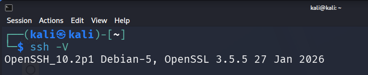
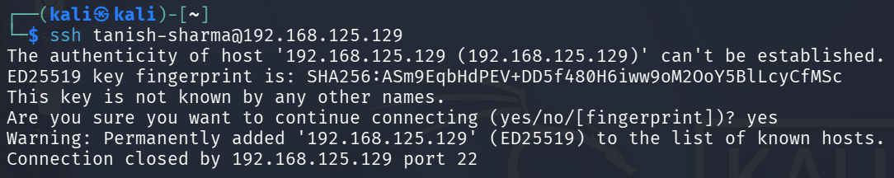
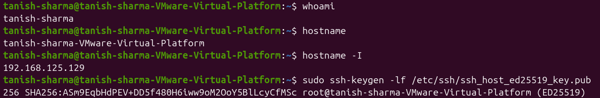
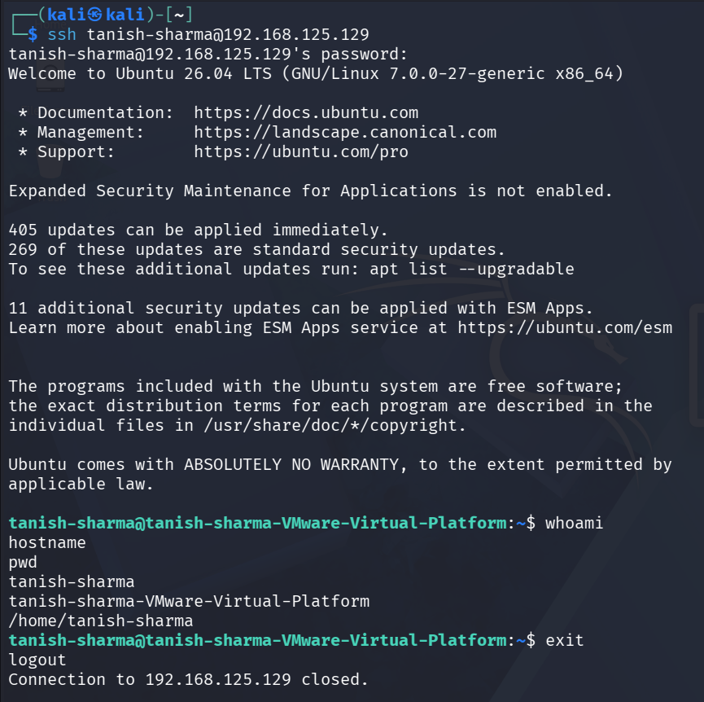
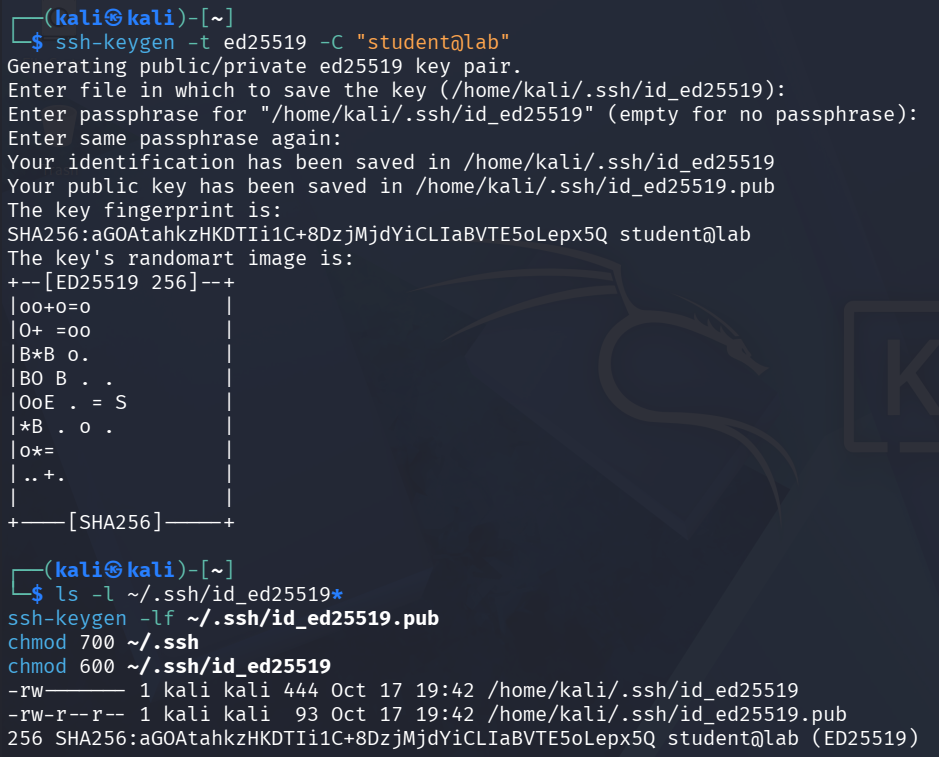
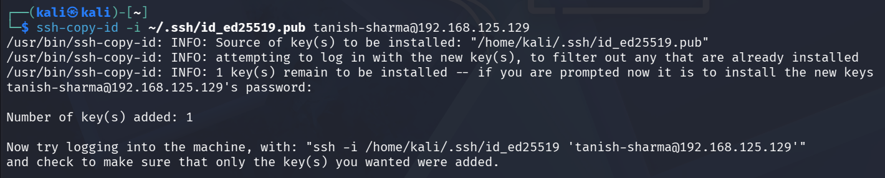
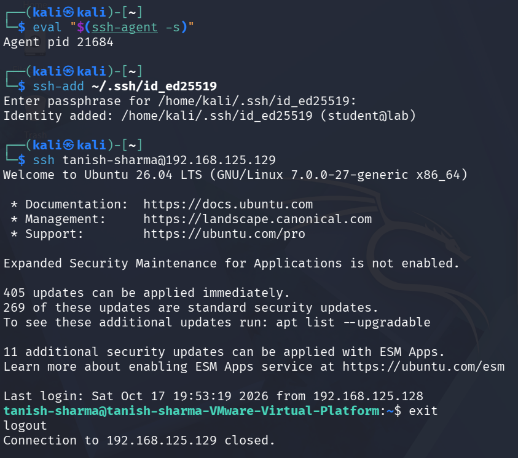

# Experiment 6: Establish Secure Remote Login Using SSH

## Aim

To demonstrate secure remote server access using SSH with password-based and public-key authentication.

---

## Objective

The objectives of this experiment are:

- To check the installed OpenSSH client on Kali Linux.
- To install and configure the OpenSSH server on Ubuntu.
- To establish a password-based SSH connection between Kali Linux and Ubuntu.
- To verify the remote account, server hostname, and working directory.
- To generate an Ed25519 SSH key pair on the client.
- To inspect the generated key files and public-key fingerprint.
- To install the client's public key on the Ubuntu server.
- To test public-key authentication without password fallback.
- To examine SSH host-key verification and changed host-key warnings.
- To understand the importance of protecting SSH private keys and verifying server identity.

---

## Requirements

- Kali Linux
- Ubuntu Linux
- OpenSSH client
- OpenSSH server
- Linux Terminal
- GitHub
- Basic knowledge of Linux commands and SSH

---

## Theory

### Secure Shell (SSH)

SSH is a network protocol used to establish secure remote connections between computers. It encrypts communication between the client and server, helping protect transmitted data and authentication information.

### OpenSSH Client and Server

OpenSSH is an open-source implementation of the SSH protocol. The SSH client initiates a connection to a remote system, while the SSH server accepts connections and authenticates users. SSH commonly uses TCP port 22.

### Password-Based Authentication

Password-based authentication verifies a user's identity by requiring the account password. In this experiment, Kali Linux was used as the client to access the Ubuntu server through an SSH connection.

### Public-Key Authentication

Public-key authentication uses a cryptographic key pair consisting of a private key and a public key. The private key remains on the client, while the corresponding public key is stored in the server account's `authorized_keys` file. The client can then authenticate using the private key instead of relying on the account password.

### SSH Host-Key Fingerprint

A host-key fingerprint is a short representation of the server's public host key. It helps the user verify the identity of the remote server before trusting the connection.

### `known_hosts` File

The `known_hosts` file stores server host keys previously accepted by the SSH client. If the server presents a different host key, SSH may display a changed-host-identification warning. The new key must be independently verified before reconnecting.

### SSH Agent

The SSH agent is a background process that holds private keys for use during authentication. Adding a private key to the agent allows it to be used for subsequent SSH connections.

---

## Procedure

### Step 1: Check the SSH Client

The installed OpenSSH client on Kali Linux was checked using:

`ssh -V`

The command displayed the installed SSH client version and confirmed that the client utility was available.

---

### Step 2: Install and Configure the SSH Server

On Ubuntu, the OpenSSH server was installed if required. The SSH service was started and enabled using:

`sudo systemctl enable --now ssh`

The service status was checked using:

`systemctl status ssh --no-pager`

The following command was used to verify that SSH was listening on TCP port 22:

`sudo ss -tlnp | grep ':22'`

The server's username, hostname, IP address, and SSH host-key fingerprint were also examined during the setup.

The Ubuntu-side commands are documented in [`server_commands.sh`](Codes/Server_commands.sh).

---

### Step 3: Establish a Password-Based Connection

The Kali Linux client was used to connect to the Ubuntu server using:

`ssh ayush-raina@192.168.125.129`

After verifying the server's host-key fingerprint, the Ubuntu account password was entered to establish the remote shell.

---

### Step 4: Verify the Remote Shell

Inside the SSH session, the following commands were executed:

- `whoami` — displays the remote account username.
- `hostname` — displays the Ubuntu server hostname.
- `pwd` — displays the current working directory.

These commands verified that the SSH session provided access to the intended remote system. The `exit` command was then used to return to Kali Linux.

---

### Step 5: Generate an SSH Key Pair

An Ed25519 SSH key pair was generated on Kali Linux using:

`ssh-keygen -t ed25519 -C "student@lab"`

The private key remained on the client, while the public key was prepared for installation on the Ubuntu server.

The generated key files were listed using:

`ls -l ~/.ssh/id_ed25519*`

The client's public-key fingerprint was examined using:

`ssh-keygen -lf ~/.ssh/id_ed25519.pub`

These commands were used to inspect the generated key files and identify the client's public key by its fingerprint.

---

### Step 6: Install the Public Key

Appropriate permissions were configured for the SSH directory and private key using:

`chmod 700 ~/.ssh`

`chmod 600 ~/.ssh/id_ed25519`

The public key was then transferred to the Ubuntu account using:

`ssh-copy-id -i ~/.ssh/id_ed25519.pub ayush-raina@192.168.125.129`

This command added the public key to the account's `authorized_keys` file, allowing the server to authorize authentication using the corresponding private key.

---

### Step 7: Test Key-Based Authentication

Public-key authentication was tested with password authentication disabled using:

`ssh -o PreferredAuthentications=publickey -o PasswordAuthentication=no ayush-raina@192.168.125.129`

Inside the remote shell, the following commands were executed:

- `whoami` — verifies the remote account.
- `hostname` — verifies the remote server.

The `exit` command was then used to return to Kali Linux.

The SSH agent was started using:

`eval "$(ssh-agent -s)"`

The private key was added to the agent using:

`ssh-add ~/.ssh/id_ed25519`

A subsequent SSH connection was established using:

`ssh ayush-raina@192.168.125.129`

The `exit` command was used to terminate the remote session and return to Kali Linux.

---

### Step 8: Test Changed Host-Key Detection

The SSH host-key verification mechanism was examined to understand what happens when the server presents a different host key from the one previously stored in the client's `known_hosts` file.

SSH displays a warning about the changed host identification, indicating that the server's identity must be independently verified before reconnecting. Such a change may occur after a legitimate server rebuild or host-key replacement, but it may also indicate a possible man-in-the-middle attack.

The new host key should therefore be verified through a trusted method before the user accepts it and reconnects.

---

## Improvement: SSH Host-Key Change Detection

### Description

As an improvement to the basic remote-login experiment, SSH host-key verification was examined when the server presented a host key different from the one previously stored in the client's `known_hosts` file.

SSH displayed a warning about the changed host identification. This demonstrated how SSH alerts users to an unexpected change in server identity.

A changed host key does not automatically prove that an attack has occurred. It may result from a legitimate server rebuild or host-key replacement, but it can also indicate a possible man-in-the-middle attack. The fingerprint should be verified independently before the new key is accepted.

This improvement highlighted the importance of host-key verification in secure remote administration.

---

## Files Included

### Code Files

#### [`server_commands.sh`](Codes/Server_commands.sh)

Contains the Ubuntu-side commands used to install and start the OpenSSH server, check the service status, verify that SSH is listening on port 22, inspect server information, and display the server's SSH host-key fingerprint.

#### [`client_commands.sh`](Codes/Client_commands.sh)

Contains the Kali Linux commands used to check the SSH client, establish remote connections, generate and inspect the Ed25519 key pair, configure permissions, transfer the public key, test public-key authentication, and use the SSH agent.

---

### Output Files

The `Outputs` folder contains the screenshots documenting the experiment:

The current screenshots are the original captures and still show the previous account. Replace them with genuine screenshots from the `ayush-raina` account when available.

- `ss1.png` — SSH client version check
- `ss2.png` — Password-based SSH connection
- `ss3.1.png` — SSH key pair generation
- `ss3.2.png` — Key files and public-key fingerprint
- `ss4.png` — SSH key permissions and public-key installation
- `ss5.1.png` — Public-key authentication test
- `ss5.2.png` — SSH agent and subsequent connection
- `ss6.png` — SSH reconnection
- `ss7.png` — SSH host-key verification

---

## Result

The OpenSSH client and server were examined, and a password-based SSH connection was established between Kali Linux and Ubuntu. An Ed25519 key pair was generated, and the public key was transferred to the Ubuntu account. Public-key authentication was tested with password authentication disabled, and the SSH agent was used to manage the private key. The experiment also examined the significance of changed host-key warnings when verifying server identity.

---

## Conclusion

The experiment demonstrated secure remote access using SSH through password-based and public-key authentication. It also highlighted the importance of protecting private keys, managing SSH authentication, and verifying server host keys to reduce the risk of unauthorized access and potential man-in-the-middle attacks.
