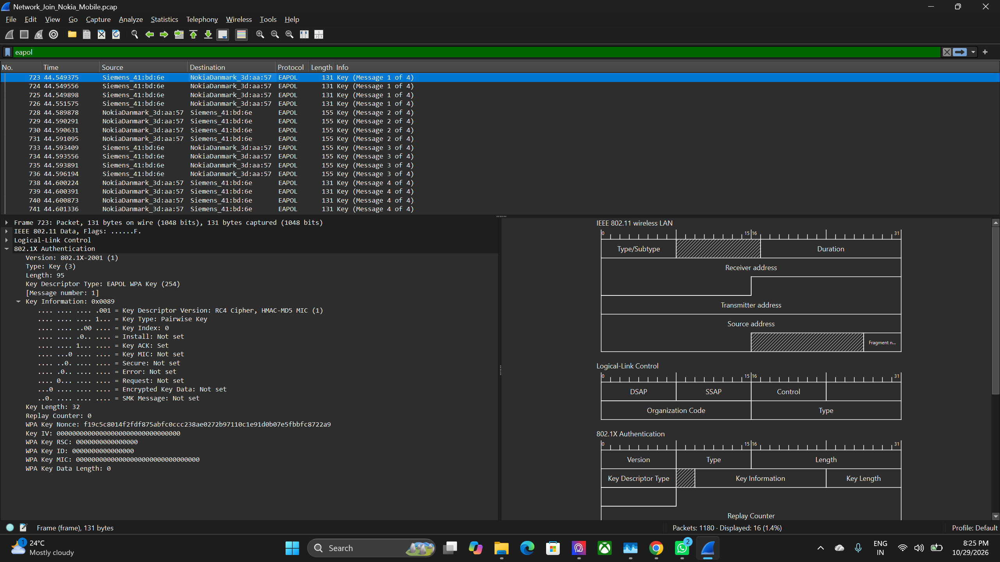
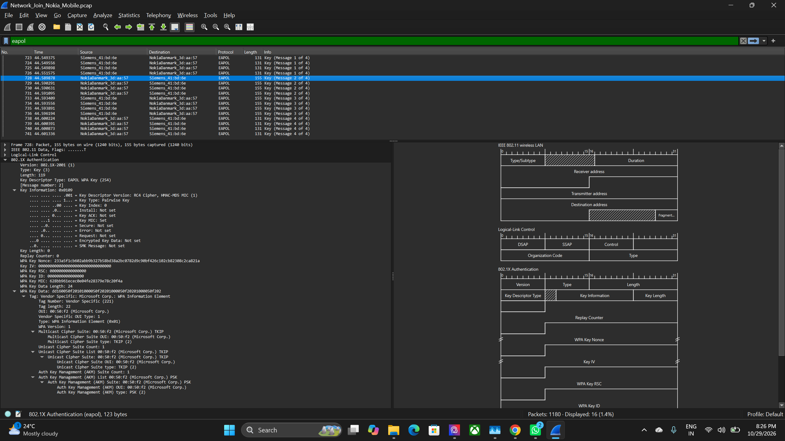
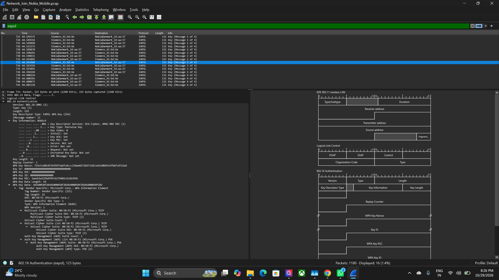
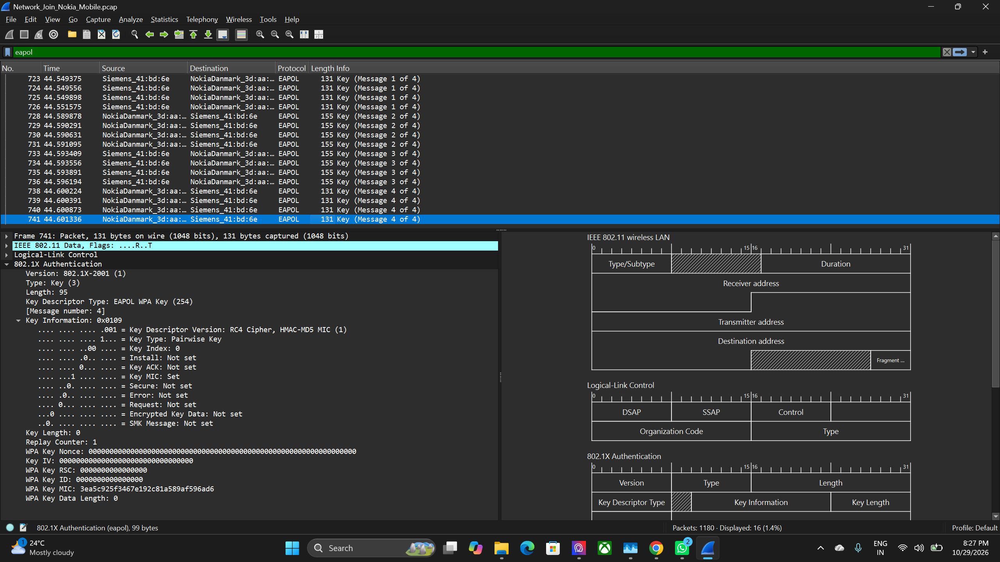

# Experiment 7: Analyze WPA2 Wireless Security and Capture Handshake with Wireshark

## Aim

To capture and analyze the WPA2 four-way handshake process using Wireshark to understand secure wireless communication.

---

## Objective

The objectives of this experiment are:

- To capture wireless authentication and key-management packets using Wireshark.
- To understand the role of WPA2 in securing wireless communication.
- To identify EAPOL packets associated with the WPA2 four-way handshake.
- To analyze the four handshake messages.
- To examine nonce, replay counter, MIC, and key-information fields.
- To understand how the handshake supports session-key establishment and message-integrity verification.
- To examine the role of authorized wireless decryption settings in packet analysis.

---

## Requirements

- Wireshark
- A wireless network and suitable packet-capture setup
- A compatible wireless interface for monitor-mode capture, where supported
- A WPA2-protected wireless network
- A saved packet capture file
- Basic knowledge of wireless networking and packet analysis

---

## Theory

### WPA2 Wireless Security

Wi-Fi Protected Access 2 (WPA2) is a wireless security protocol that protects wireless communication through authentication and encryption. It uses key-management procedures to establish the cryptographic keys required for secure data transmission.

### Wireshark

Wireshark is a network protocol analyzer used to capture and inspect network packets. It allows users to examine protocol fields, identify communication patterns, and analyze authentication exchanges.

### Monitor Mode

Monitor mode allows a compatible wireless adapter to capture wireless frames without operating only as a normally connected client. Its availability depends on the wireless adapter, driver, operating system, and capture setup.

### EAPOL

Extensible Authentication Protocol over LAN (EAPOL) is used for authentication and key-management exchanges. During WPA2 key establishment, EAPOL-Key frames carry information associated with the four-way handshake.

### WPA2 Four-Way Handshake

The four-way handshake is an exchange between a wireless client and an access point. It allows both sides to derive and install session keys and confirm possession of the required key material.

The four messages have distinct roles:

- **Message 1:** The access point sends a nonce and replay-counter information to the client.
- **Message 2:** The client returns its nonce and a Message Integrity Code (MIC).
- **Message 3:** The access point sends key-installation and key-confirmation information, including relevant key-information flags.
- **Message 4:** The client confirms the handshake exchange, with integrity-related information.

### Nonce, Replay Counter, and MIC

A nonce is a value used during key establishment to contribute to the creation of session keys. A replay counter helps identify and order handshake exchanges. A Message Integrity Code (MIC) helps verify the integrity and authenticity of a handshake message.

---

## Procedure

### Step 1: Select the Wi-Fi Interface

Wireshark was opened, and the available wireless interface was selected for packet capture. The appropriate capture interface is required to observe the wireless traffic relevant to the experiment.

### Step 2: Enable Monitor Mode

The capture options were opened in Wireshark, and monitor mode was enabled for the wireless interface where supported by the adapter and capture environment.

Monitor mode allows a compatible wireless adapter to capture relevant wireless frames that may not be visible through ordinary client-mode capture.

### Step 3: Apply the EAPOL Capture Filter

The following capture filter was used:

`eapol`

This filter restricts the capture to EAPOL traffic, helping identify authentication and key-management frames associated with the WPA2 handshake.

### Step 4: Capture the Handshake Packets

Packet capture was started, and the EAPOL packets exchanged during the wireless handshake were collected. The capture was stopped after obtaining the four handshake messages.

The captured packets were identified in Wireshark as **Key (Message 1 of 4)**, **Key (Message 2 of 4)**, **Key (Message 3 of 4)**, and **Key (Message 4 of 4)**.

#### Message 1 of 4

The first handshake message was selected to inspect the EAPOL-Key fields, including the message number, replay counter, nonce, and key-information fields.

#### Message 2 of 4

The second message was examined to identify the client's response, including its nonce and MIC-related fields.

#### Message 3 of 4

The third message was inspected to examine the key-information flags, including the Install, Key ACK, and Key MIC indicators shown in the packet details.

#### Message 4 of 4

The fourth message was selected to inspect the final handshake exchange and its integrity-related fields.

### Step 5: Analyze the Handshake Messages

The captured EAPOL-Key packets were examined by selecting individual packets and expanding the relevant protocol fields in Wireshark.

The analysis focused on:

- Message number within the four-way handshake
- WPA key nonce
- Replay counter
- Message Integrity Code (MIC)
- Key-information flags, including Install, Key ACK, and Key MIC
- Differences between the fields present in the four messages

This analysis demonstrated how the messages contribute to key establishment and confirmation between the wireless client and access point.

### Step 6: Save the Capture

The captured packets were saved in a packet-capture file for future reference and analysis.

The file `Network_Join_Nokia_Mobile.pcap` is included in the `Outputs` folder. It can be opened in Wireshark to inspect the EAPOL packets, apply filters, and review the handshake fields again.

---

## Improvement: Authorized Wireless Traffic Decryption

### Description

As an improvement to the basic experiment, Wireshark's wireless decryption settings were configured using the authorized WPA2 network key. The captured wireless traffic was then examined for frames that could be decrypted using the available key and capture information.

This extended the analysis beyond identifying the four EAPOL handshake messages and helped demonstrate the relationship between wireless encryption and packet inspection.

Successful decryption depends on the correct key, supported security configuration, and sufficient captured handshake information. Capturing the handshake alone does not automatically decrypt the wireless traffic.

---

## Files Included

### Output Files

The `Outputs` folder contains the following screenshots and packet capture:

- `step1.png` — EAPOL Key Message 1 of 4
- `step2.png` — EAPOL Key Message 2 of 4
- `step3.png` — EAPOL Key Message 3 of 4
- `step4.png` — EAPOL Key Message 4 of 4
- [`Network_Join_Nokia_Mobile.pcap`](Outputs/Network_Join_Nokia_Mobile.pcap) — Saved packet capture for further inspection in Wireshark

The packet capture can be reopened to inspect the captured EAPOL handshake and analyze the available packet fields.

---

## Result

The WPA2 four-way handshake was captured and analyzed using Wireshark. Four EAPOL-Key messages were identified, and their nonce, replay-counter, MIC, and key-information fields were examined. The packet analysis demonstrated the role of the handshake in establishing session keys and supporting integrity verification during secure wireless communication.

---

## Conclusion

The experiment demonstrated how Wireshark can capture and analyze WPA2 EAPOL handshake messages to understand wireless authentication, session-key establishment, and the security mechanisms used in wireless communication.
